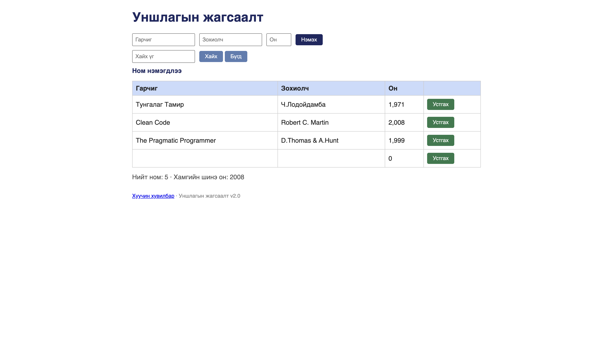

# BUG-01: Гарчиг болон утга хоосон байхад ном алдаагүйгээр нэмэгдэж байна

Орчин:  Уншлагын жагсаалт v2.0, Chrome, macOS, 2026-10-16
Урьдчилсан нөхцөл: node app.js-ийг шинээр асаасан (анхны 3 ном)

## Дахин гаргах алхам
1. Браузераар http://localhost:3000 руу орох.
2. Гарчиг, зохиолч, он талбаруудыг хоосон орхих.
3. "Нэмэх" товчлуур дээр дарж шалгах.

Хүлээгдэж байсан: Ном нэмэхэд Гарчиг, Зохиолч, Он гурван талбар бүгд заавал бөглөгдсөн байх ёстой; дутуу бол ном нэмэгдэхгүй, ойлгомжтой алдааны мессеж харагдана.
Бодит үр дүн:     Ямар ч утгагүйгээр хоосон мөр нэмэгдэж "Ном нэмэгдлээ" гэсэн мессеж гарч байна.

Ноцтой байдал: Major — Өгөгдлийн бүрэн бүтэн байдал алдагдана.
Хавсралт:      
Олдсон аялал:  Supermodel (GUI)