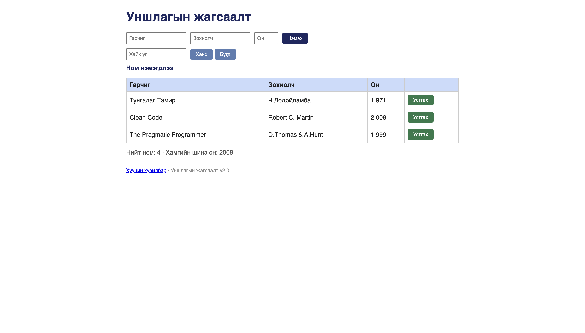

# BUG-02: «Нийт ном» тоолуур хүснэгтэд буй бодит номын тооноос зөрүүтэй байна

Орчин:  Уншлагын жагсаалт v2.0, Chrome, macOS, 2026-10-16
Урьдчилсан нөхцөл: node app.js-ийг шинээр асаасан (анхны 3 ном)
Дахин баталгаажсан: 2026-10-23 session-д (нотолгоо: screenshots/2026-10-23/03-bug04-input-not-cleared.png — 5 мөр үед Нийт ном: 6)

## Дахин гаргах алхам
1. Аппыг шинээр асааж http://localhost:3000 руу орох.
2. Хүснэгт дэх бодит номын тоо болон доод талын "Нийт ном:" статистикийг харьцуулах.

Хүлээгдэж байсан: «Нийт ном» тоолуур хүснэгтэд буй номын тоотой яг тэнцүү буюу 3 байх ёстой.
Бодит үр дүн:     Бодит номын тоо 3 байхад тоолуур дээр "Нийт ном: 4" гэж буруу харагдаж байна.

Ноцтой байдал: Minor — Статистик мэдээллийн зөрүү.
Хавсралт:      
Олдсон аялал:  Supermodel (GUI)