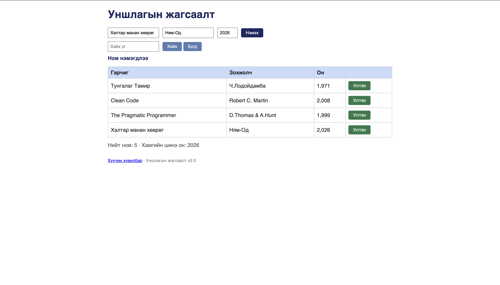

# BUG-04: Ном амжилттай нэмэгдсэний дараа оролтын талбарууд (input) цэвэрлэгдэхгүй байна

Орчин:  Уншлагын жагсаалт v2.0, Chrome, macOS, 2026-10-16
Урьдчилсан нөхцөл: node app.js-ийг шинээр асаасан

## Дахин гаргах алхам
1. http://localhost:3000 руу орох.
2. Гарчиг, Зохиолч, Он талбарт утга оруулж "Нэмэх" товч дээр дарна.
3. Ном хүснэгтэд нэмэгдсэний дараа оролтын талбаруудыг (input) ажиглана.

Хүлээгдэж байсан: Ном амжилттай нэмэгдсэний дараа хэрэглэгчийн тав тухыг бодон оролтын талбарууд хоосон болж цэвэрлэгдэх (reset/clear) ёстой.
Бодит үр дүн:     "Ном нэмэгдлээ" гэсэн мессеж гарч хүснэгтэд нэмэгдсэн боловч input талбаруудад бичсэн утгууд хэвээрээ үлдэнэ.

Ноцтой байдал: Minor / UX — Хэрэглэгч дахин ном нэмэхийн тулд заавал өөрөө арилгах шаардлагатай болж байна.
Хавсралт:      
Олдсон аялал:  Supermodel (GUI)