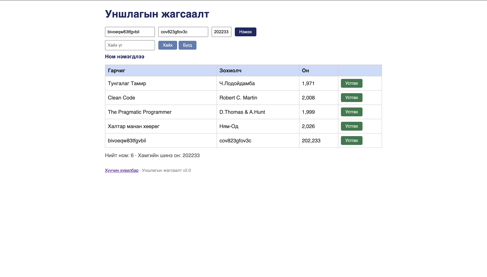

# BUG-05: Устгах үйлдэл хийхэд "Ном нэмэгдлээ" гэсэн буруу мессеж харагдаж байна

Орчин:  Уншлагын жагсаалт v2.0, Chrome, macOS, 2026-10-16
Урьдчилсан нөхцөл: node app.js-ийг шинээр асаасан

## Дахин гаргах алхам
1. http://localhost:3000 руу орох.
2. Хүснэгтэд байгаа аль нэг номын арын «Устгах» товчийг даран (энэ товч ногоон өнгөтэй — үүнийг тусдаа BUG-07 гэж тэмдэглэсэн).
3. Мэдэгдэл харагдах хэсгийг ажиглана.

Хүлээгдэж байсан: Үйлдэл бүрийн дараах мессеж тухайн үйлдэлдээ тохирно (Ном устгагдлаа гэх мэт).
Бодит үр дүн:     Номыг устгасан атал дээр нь "Ном нэмэгдлээ" гэсэн тохиромжгүй мессеж гарч байна.

Ноцтой байдал: Minor — Хэрэглэгчийг төөрөгдүүлсэн мессеж.
Хавсралт:      
Олдсон аялал:  Supermodel (GUI)