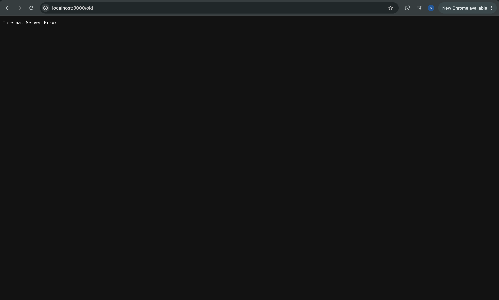

# BUG-06: Footer хэсгийн "Хуучин хувилбар" линк дээр дарахад 500 Internal Server Error гарч байна

Орчин:  Уншлагын жагсаалт v2.0, Chrome, macOS, 2026-10-16
Урьдчилсан нөхцөл: node app.js-ийг шинээр асаасан
Дахин баталгаажсан: 2026-10-23 session-д (нотолгоо: screenshots/2026-10-23/05-bug06-old-500.png)

## Дахин гаргах алхам
1. http://localhost:3000 руу орох.
2. Хуудасны доод хэсэгт (Footer) байрлах "Хуучин хувилбар" холбоос дээр дарна.
3. Браузерын гарцыг харна.

Хүлээгдэж байсан: Бүх хуудас болон линкүүд алдаагүй ажиллах ёстой.
Бодит үр дүн:     `/old` замаар ороход сервер талаас HTTP 500 Internal Server Error гарч, хуудас ажиллахгүй байна.

Ноцтой байдал: Major — Системийн дотоод алдаа (500) шууд гарч байна.
Хавсралт:      
Олдсон аялал:  Fed-Ex / Navigation Tour