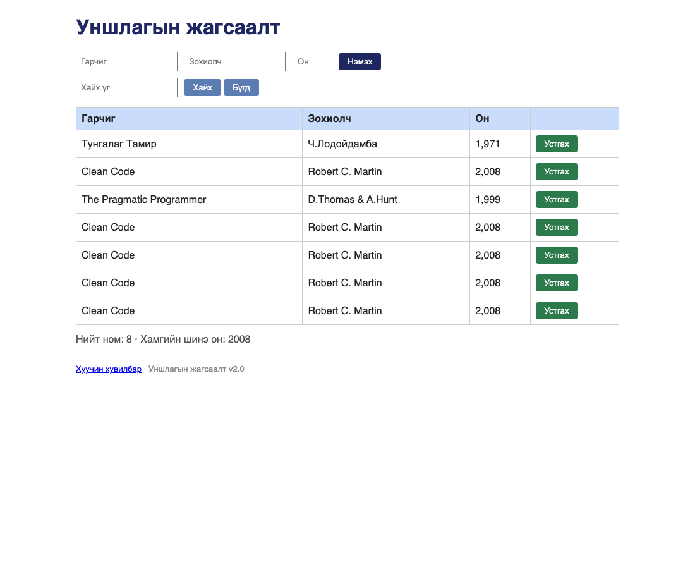

# BUG-08: Ижил гарчиг, зохиолчтой номыг дахин дахин нэмэх боломжтой байна

Орчин:  Уншлагын жагсаалт v2.0, Chrome, curl, macOS, 2026-10-23
Урьдчилсан нөхцөл: node app.js-ийг шинээр асаасан (анхны 3 ном)

## Дахин гаргах алхам
1. Терминал дээр дараах команд хоёр удаа гүйцэтгэх:
   curl -i -X POST localhost:3000/api/books -H "Content-Type: application/json" -d '{"title":"Clean Code","author":"Robert C. Martin","year":2008}'
2. Браузераар http://localhost:3000 руу орж хүснэгтийг харах.

Хүлээгдэж байсан: Ижил гарчиг, зохиолчтой ном давхардуулж нэмэгдэхгүй.
Бодит үр дүн:     HTTP 201 Created буцаж, ижил ном бүр тусдаа бүртгэгдэв (id 2, 4, 5, 6, 7).

Ноцтой байдал: Major — Давхар бүртгэл өгөгдлийн бүрэн бүтэн байдалд саад учруулна.

Хавсралт:      
Нотолгоо:      evidence/2026-10-23/bug08-duplicates.txt
Олдсон аялал:  Saboteur (API) — session дараах давталт (2026-10-23)
