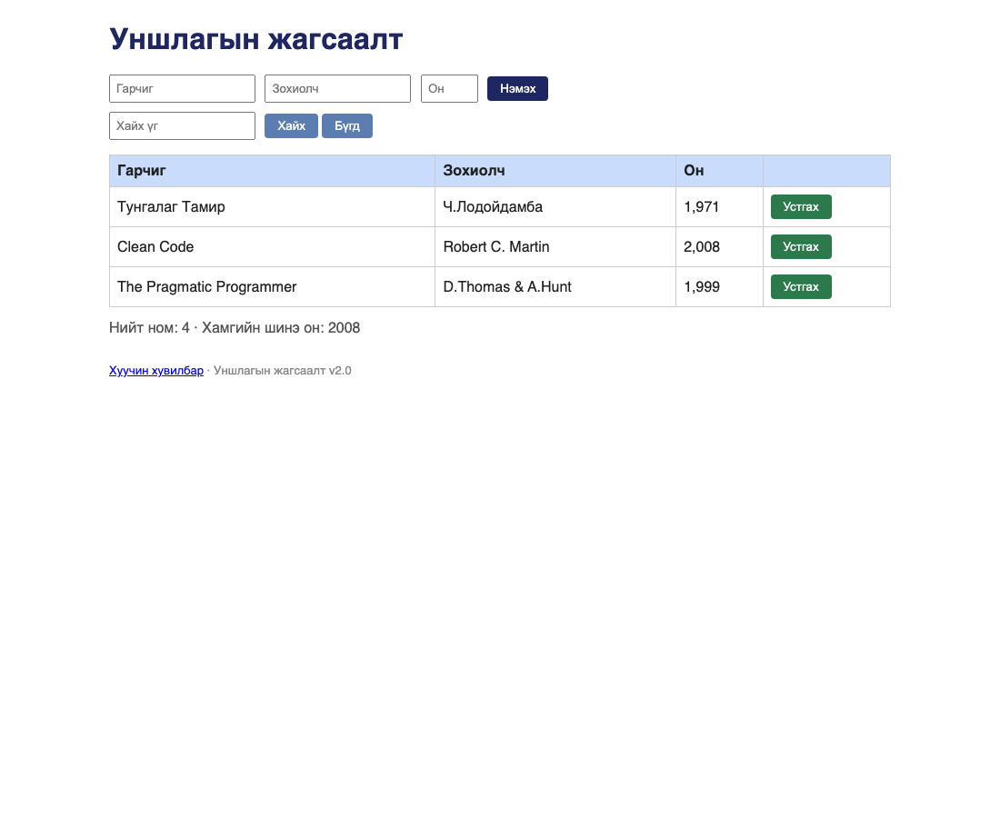

# BUG-09: Он талбарт хязгаар тавигддаггүй, он мянган таслалтай харагдана

Орчин:  Уншлагын жагсаалт v2.0, Chrome, curl, macOS, 2026-10-23
Урьдчилсан нөхцөл: node app.js-ийг шинээр асаасан (анхны 3 ном)

## Дахин гаргах алхам
1. Терминал дээр дараах командыг ажиллуулах:
   curl -i -X POST localhost:3000/api/books -H "Content-Type: application/json" -d '{"title":"Хуучин судар","author":"Тодор","year":-250}'
2. http://localhost:3000 руу орж хүснэгтийг харах.

Хүлээгдэж байсан: Он нь 1000-2100 хоорондох бүхэл тоо байх ёстой; зөрсөн оныг хүлээн авахгүй. Хүснэгтэд он энгийн тоогоор (ж: 1999) харагдана.
Бодит үр дүн:     Сөрөг он (-250) HTTP 201 Created-ээр хүлээн авагдав. "1934" гэсэн string түүвэр он мөн хүлээгдэж хадгалагдлаа. Хүснэгтэд бүх он "1,971", "2,008" гэж мянган таслалтай харагдана.

Ноцтой байдал: Major — Спецификаас хэд хэдэн талаар зөрсөн: хязгаар, бүхэл тоо, харагцах формат.
Хавсралт:      
Нотолгоо:      evidence/2026-10-23/api-validation-tests.txt
Олдсон аялал:  Saboteur (API) — спецификац дүрэм 2-ыг шалгахад (2026-10-23)
